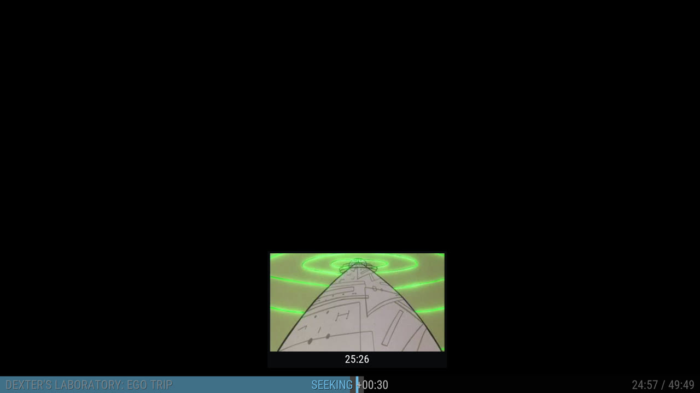
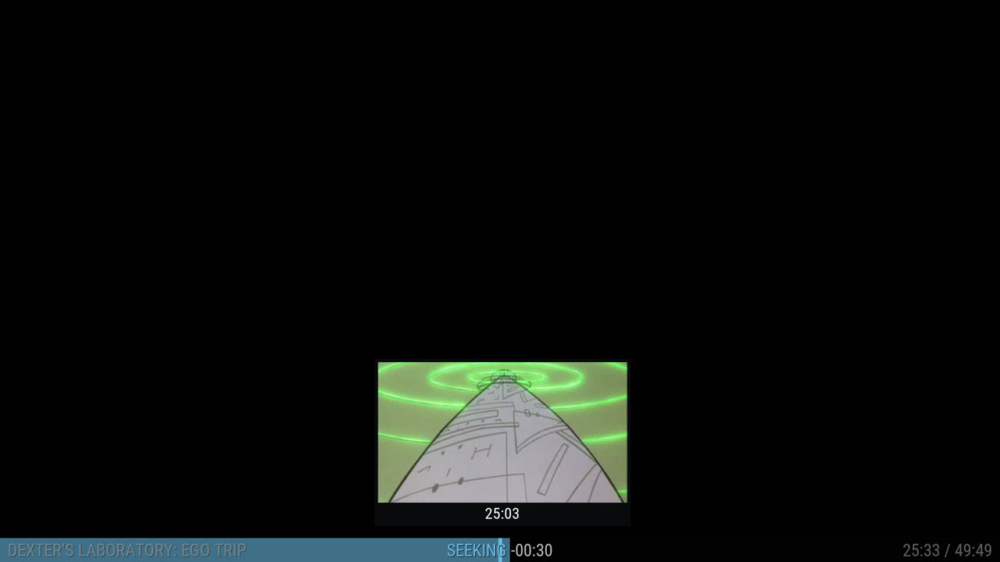

# Seek Preview for Kodi

`service.seekpreview` shows a small picture of the spot you are skipping to, just above the seek bar, with the time under it. It works in any skin, because the add-on draws the box itself and changes no skin files.





Screenshots: Kodi 22 on CoreELEC, skin Aeon Nox: SiLVO. The video is black only because Kodi's screenshot does not capture the video layer on that device.

## Install

1. Download `service.seekpreview-<version>-lite.zip` from the [Releases page](https://github.com/easter478/kodi-seek-preview/releases).
2. In Kodi: Add-ons → Install from zip file (allow unknown sources first).

## Requirements

**The lite package does not include ffmpeg.** The add-on needs an ffmpeg program on the device to make the pictures. Without one it shows no preview.

| Device | How to get ffmpeg |
|---|---|
| CoreELEC / LibreELEC | Install the **FFmpeg Tools** add-on from the CoreELEC or LibreELEC repository (Program add-ons), then restart Kodi |
| Linux | Install it with the package manager, for example `sudo apt install ffmpeg` |
| Windows | Download it from [ffmpeg.org](https://ffmpeg.org/download.html) and put the folder with `ffmpeg.exe` on the `PATH` |
| Android / Fire OS | Not supported |

Kodi 19 or newer. Nothing else is needed.

## Recommended settings

All settings are under the add-on's Configure.

| Setting | Recommended | Why |
|---|---|---|
| Kodi's skipping → Kodi's skip settings | Suggested for the preview | Sets Kodi's skip delay to 1000 ms and the skip step to 10 seconds each press. The picture then moves evenly, and Kodi jumps once, when you stop pressing |
| General → One frame every | 10 seconds | Matches the 10-second skip step |
| General → Make frames ahead of time | On | The picture is ready when you skip |
| Look → Fit to the skin's seek bar | Automatic | Aeon Nox: SiLVO is fitted. On other skins set the distance values under Look |

Notes:

- The skip delay and skip steps are Kodi's own settings (Settings → Player → Videos). The add-on only changes them if you choose Suggested or Custom. Choose "Leave as they are" to put the old values back; do this before you uninstall the add-on.
- The preview shows during Kodi's skip delay. With a delay of 0 there is nothing to preview.
- "Look → Move up or down" shifts the box in small steps if it does not sit right on your seek bar.

## What works

- Local files, network shares (SMB, NFS) and http streams.
- Not supported: discs, live TV and DRM-protected streams.
- In the first seconds of a video, or at a spot whose picture is not made yet, the first skip can show no picture.

## How it works

- While `Player.Seeking` is true, the service opens its own non-modal window over the video, so remote keys still reach the player.
- ffmpeg makes one small JPEG per step: one decoder thread, keyframes only, low priority, and none while memory is low.
- Network shares are read through Kodi and passed to ffmpeg over a local connection, so share passwords stay inside Kodi.
- On Linux the pictures are kept in memory (`/tmp`) and removed when playback stops.

## Build and test

```bash
python tests/test_frames.py
python tools/build.py
```

`tools/build.py` writes the zips to `dist/`. If ffmpeg programs are placed in `service.seekpreview/bin/<platform>/` (`linux-aarch64`, `linux-armv7`, `linux-x86_64`, `windows-x86_64`), it also builds a full package that includes them.

## Status

Early version, tested on one device (CoreELEC, Kodi 22, Aeon Nox: SiLVO). Use it at your own risk.

## Licence

GPL-3.0-or-later, see `LICENSE.txt`.
